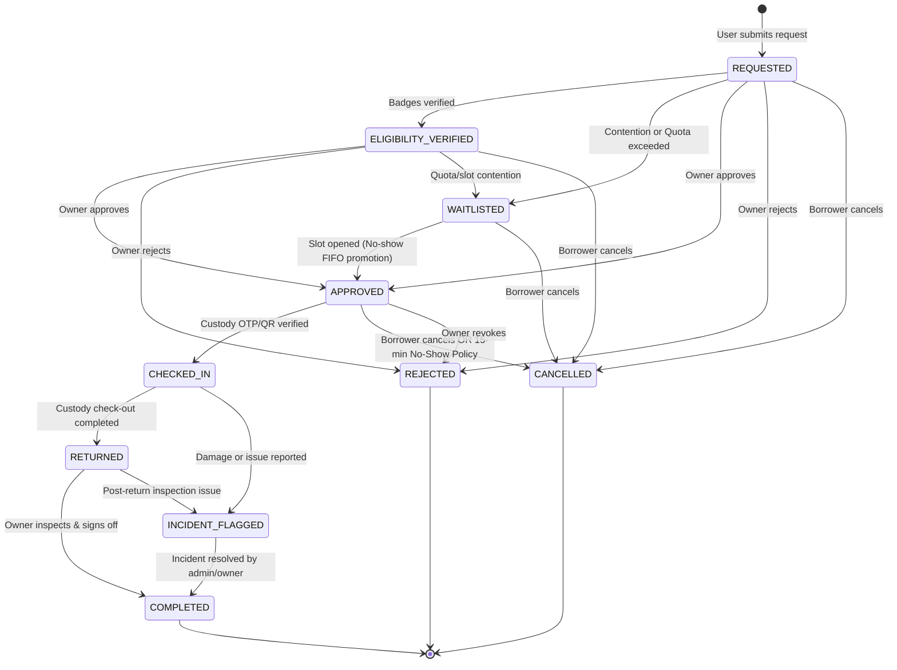

# OpenResource — Member 2 Backend Integration Guide

This document defines the complete backend architecture, API contracts, domain models, authentication requirements, and integration workflows developed by **Member 2** on branch `sumit`. It is intended as the primary technical specification for merging with **Member 1**'s branch (Resource CRUD, search/discovery, judge bar, and application shell).

---

## 1. Backend Architecture & Service Responsibilities

The Member 2 backend is implemented in TypeScript using Express 5, running on Node.js with Vite dev server integration. The system enforces strict separation of concerns across routes, controllers, domain services, storage adapters, and error-handling layers.

```
┌────────────────────────────────────────────────────────────────────────┐
│                        HTTP / JSON API Layer                           │
│     /api/bookings/*                        /api/notifications/*        │
└───────────────────┬────────────────────────────────────┬───────────────┘
                    │                                    │
           ┌────────▼────────┐                  ┌────────▼────────┐
           │ Auth Middleware │                  │ Auth Middleware │
           └────────┬────────┘                  └────────┬────────┘
                    │                                    │
           ┌────────▼────────┐                  ┌────────▼────────┐
           │   Controllers   │                  │   Controllers   │
           └────────┬────────┘                  └────────┬────────┘
                    │                                    │
    ┌───────────────┴────────────────────────────┐       │
    │              Domain Services               │       │
    │  ┌───────────────────┐ ┌────────────────┐  │       │
    │  │  BookingService   │ │ CustodyService │  │       │
    │  └─────────┬─────────┘ └───────┬────────┘  │       │
    │            │                   │           │       │
    │  ┌─────────▼───────────────────▼────────┐  │       │
    │  │       SchedulerService (No-Show)     │  │       │
    │  └─────────────────┬────────────────────┘  │       │
    │                    │ (Domain Events)       │       │
    │  ┌─────────────────▼────────────────────┐  │       │
    │  │    MinimalNotificationDispatcher    │──┼───────┘
    │  └─────────────────┬────────────────────┘  │   (Subscribes)
    │                    ▼                       │
    │  ┌──────────────────────────────────────┐  │
    │  │         NotificationService          │  │
    │  └─────────────────┬────────────────────┘  │
    └────────────────────┼───────────────────────┘
                         │
             ┌───────────▼───────────┐
             │ StorageAdapter        │
             │ (In-Memory + Locking) │
             └───────────────────────┘
```

### Key Service Responsibilities
1. **`BookingService`** (`server/services/booking.service.ts`):
   - Validates ISO 8601 timestamps, duration constraints (<= 24 hours), and rejects past time slots.
   - Evaluates weekly resource quotas and checks student safety badge qualifications against resource requirements.
   - Computes time-slot overlap under per-resource mutex locks.
   - Executes valid lifecycle state transitions (`REQUESTED` → `APPROVED` → `CHECKED_IN`, etc.).
   - Enforces RBAC permissions: Only resource owners or admins can approve/reject; borrowers can cancel their own bookings.
   - Applies PII masking based on requester role and booking relationship.
2. **`CustodyService`** (`server/services/custody.service.ts`):
   - Generates cryptographically unpredictable 6-digit OTPs and 24-byte base64url QR verification tokens with short TTL (default 10 min).
   - Stores one-way SHA-256 hashes (`otpHash`, `qrTokenHash`); never persists plaintext credentials.
   - Enforces maximum attempt limits (3 attempts) with constant-time hash comparisons (`crypto.timingSafeEqual`) to prevent timing attacks.
   - Executes atomic transitions to `CHECKED_IN` and `RETURNED` / `INCIDENT_FLAGGED`.
   - Restricts custody operations to authorized borrowers, the actual resource owner, and admins.
3. **`SchedulerService`** (`server/services/scheduler.service.ts`):
   - Enforces the 15-minute campus no-show policy.
   - Runs deterministic clock evaluations over `APPROVED` bookings without check-in timestamps.
   - Automatically reclaims slots (`CANCELLED`) and invalidates active credentials.
   - Promotes earliest eligible `WAITLISTED` bookings to `APPROVED` using FIFO ordering.
   - Guaranteed singleton with duplicate timer prevention.
4. **`NotificationService`** (`server/services/notification.service.ts`):
   - Subscribes asynchronously to lifecycle domain events via `MinimalNotificationDispatcher`.
   - Sanitizes metadata to an explicit allowlist, preventing credential leaks.
   - Deduplicates rapid-fire events within a 30-second sliding window using deterministic idempotency keys.
   - Provides paginated, user-isolated notification lists and read-receipt management.
5. **`StorageAdapter`** (`server/adapters/storage.adapter.ts`):
   - High-performance in-memory repository managing Bookings, Resources, Users, Credentials, and Notifications.
   - Contains per-resource asynchronous mutex locking (`withResourceLock`) to ensure linearizable, race-free state transitions inside the Node.js process.

---

## 2. API Endpoint Reference

All endpoints adhere to the team's standard JSON envelope:
- **Success Envelope**: `{ success: true, data: T, timestamp: string }`
- **Error Envelope**: `{ error: { code: string, message: string, details?: Array<{ field?: string, message: string }> }, timestamp: string }`

### Summary of Endpoints

| Method | Endpoint | Auth Level | Allowed Roles | Description |
| :--- | :--- | :--- | :--- | :--- |
| `POST` | `/api/bookings` | Authenticated | Any authenticated user | Request a resource booking |
| `GET` | `/api/bookings` | Optional | Any (PII masked for strangers) | List bookings with optional filters |
| `GET` | `/api/bookings/:id` | Optional | Any (PII masked for strangers) | Retrieve booking details by ID |
| `GET` | `/api/bookings/user/:userId` | Optional | Self, Owner, Auditor, Admin | Member 1 integration: User booking summary & quota |
| `POST` | `/api/bookings/:id/transition` | Authenticated | Borrower, Owner, Admin (role-restricted) | Execute lifecycle state transition |
| `POST` | `/api/bookings/:id/custody` | Authenticated | Borrower, Owner, Admin | Custody actions (`GENERATE_CREDENTIAL`, `CHECK_IN`, `CHECK_OUT`) |
| `POST` | `/api/bookings/process-no-shows` | Authenticated | Lab Owner, Admin | Trigger on-demand 15-min no-show sweep |
| `GET` | `/api/notifications` | Authenticated | Recipient user only | Paginated user notifications |
| `PATCH` | `/api/notifications/:id/read` | Authenticated | Recipient user only | Mark single notification as read |
| `POST` | `/api/notifications/read-all` | Authenticated | Recipient user only | Mark all user notifications as read |
| `GET` | `/health` | Public | Any | System health check |

---

### Endpoint Specifications

#### 1. POST `/api/bookings`
Creates a booking request. Automatically verifies qualification badges and checks for scheduling contention.
- **Headers**: `Authorization: Bearer <token>` or dev test headers (`X-Test-User-Id`).
- **Body**:
  ```json
  {
    "resourceId": "res_3d_prusa",
    "startTime": "2026-11-15T10:00:00.000Z",
    "endTime": "2026-11-15T12:00:00.000Z",
    "intent": "Robotics capstone gear prototype 3D print",
    "requiresSupervision": false,
    "notes": "Using PLA filament"
  }
  ```
- **Rules**:
  - `startTime` must be before `endTime`.
  - Cannot book time slots in the past (`endTime < Date.now() - 5m`).
  - Max duration 24 hours.
  - If overlapping confirmed booking exists or weekly quota exceeded, booking is automatically placed in `WAITLISTED` status.
  - If required safety badges are held, initialized as `ELIGIBILITY_VERIFIED`; otherwise `REQUESTED`.
  - Body `userId` or `role` conflicting with caller returns `403 FORBIDDEN`.
- **Success Response (201 Created)**:
  ```json
  {
    "success": true,
    "data": {
      "booking": {
        "id": "book_1731664800000_a1b2",
        "resourceId": "res_3d_prusa",
        "resourceName": "3D Printer - Prusa MK4",
        "userId": "demo_qualified_student",
        "ownerId": "demo_lab_owner",
        "startTime": "2026-11-15T10:00:00.000Z",
        "endTime": "2026-11-15T12:00:00.000Z",
        "intent": "Robotics capstone gear prototype 3D print",
        "status": "ELIGIBILITY_VERIFIED",
        "estimatedHours": 2,
        "createdAt": "2026-11-15T09:00:00.000Z",
        "updatedAt": "2026-11-15T09:00:00.000Z",
        "history": [ ... ]
      }
    },
    "timestamp": "2026-11-15T09:00:00.100Z"
  }
  ```
- **Error Codes**: `400 VALIDATION_ERROR`, `401 UNAUTHORIZED`, `403 FORBIDDEN`, `404 RESOURCE_NOT_FOUND`.

---

#### 2. GET `/api/bookings`
List accessible bookings with optional filtering. Applies PII masking depending on authenticated caller.
- **Query Parameters**:
  - `resourceId` (optional string): Filter by resource.
  - `userId` (optional string): Filter by borrower.
  - `status` (optional string): Filter by `BookingStatus`.
  - `startDate` (optional ISO 8601 string): Filter bookings ending on or after this date.
  - `endDate` (optional ISO 8601 string): Filter bookings starting on or before this date.
- **Success Response (200 OK)**:
  ```json
  {
    "success": true,
    "data": {
      "bookings": [ ... ],
      "total": 12
    },
    "timestamp": "2026-11-15T09:05:00.000Z"
  }
  ```

---

#### 3. GET `/api/bookings/:id`
Retrieve a single booking by ID with role-based privacy masking.
- **Privacy Rules**:
  - **Borrower (Self) or Admin**: Receives full borrower profile (`id`, `name`, `email`, `phone`, `studentId`, `badges`), notes, and audit history.
  - **Resource Owner**: Receives borrower name, email, partially masked phone (`***-***-0144`), condition notes, and history for resources they own.
  - **Auditor**: Receives anonymized email (`...@audit-masked.org`), badges, and history; phone and student ID are stripped.
  - **Public / Unrelated Students**: Receives masked profile (`name: "Alice C."`, `isMasked: true`), with phone, email, studentId, badges, notes, and audit history stripped.
- **Success Response (200 OK)**:
  ```json
  {
    "success": true,
    "data": {
      "booking": {
        "id": "book_demo_101",
        "resourceId": "res_3d_prusa",
        "userId": "demo_qualified_student",
        "borrower": {
          "id": "demo_qualified_student",
          "name": "Alice Chen",
          "email": "alice.chen@openresource.demo",
          "role": "USER",
          "phone": "555-0144",
          "studentId": "STU-9901",
          "badges": ["badge_safety_101", "badge_3d_basics"]
        },
        "ownerId": "demo_lab_owner",
        "startTime": "2026-11-15T10:00:00.000Z",
        "endTime": "2026-11-15T12:00:00.000Z",
        "intent": "Robotics capstone gear prototype 3D print",
        "status": "APPROVED",
        "estimatedHours": 2,
        "createdAt": "...",
        "updatedAt": "..."
      }
    },
    "timestamp": "..."
  }
  ```
- **Error Codes**: `404 BOOKING_NOT_FOUND`.

---

#### 4. GET `/api/bookings/user/:userId`
Member 1 integration route providing a user's booking history, active quota calculations, and calendar week usage breakdown.
- **Authorization**: Accessible by the user themselves, resource owners, auditors, and administrators. Other students receive `403 FORBIDDEN`.
- **Success Response (200 OK)**:
  ```json
  {
    "success": true,
    "data": {
      "bookings": [ ... ],
      "weeklyUsage": {
        "res_3d_prusa": 4,
        "res_laser_epilog": 1.5
      },
      "weekStartDate": "2026-11-10T00:00:00.000Z"
    },
    "timestamp": "2026-11-15T09:10:00.000Z"
  }
  ```
- **Error Codes**: `403 FORBIDDEN`.

---

#### 5. POST `/api/bookings/:id/transition`
Transitions a booking through its lifecycle state machine.
- **Headers**: `Authorization: Bearer <token>` or dev test headers.
- **Body**:
  ```json
  {
    "targetStatus": "APPROVED",
    "reason": "Approved for lab session",
    "notes": "Safety briefing verified"
  }
  ```
- **Role Enforcement**:
  - `APPROVED` / `REJECTED`: Only the resource owner (who owns this specific resource) or an admin (`403 FORBIDDEN` for other owners/borrowers).
  - `CANCELLED`: The borrower, resource owner, or admin (`403 FORBIDDEN` for strangers).
  - `COMPLETED`: Resource owner or admin.
  - `CHECKED_IN` / `RETURNED`: **Prohibited via this endpoint** (`403 FORBIDDEN`). Must be performed through the custody endpoint (`/api/bookings/:id/custody`), unless performed as an explicit administrative override.
  - `ELIGIBILITY_VERIFIED` / `WAITLISTED`: Owner or admin only.
- **Concurrency & Contention**:
  - Executed inside the resource mutex lock.
  - If transitioning to `APPROVED`, verifies that no other `APPROVED` or `CHECKED_IN` booking overlaps. If an overlap is detected, returns `409 CONFLICT`.
- **Success Response (200 OK)**:
  ```json
  {
    "success": true,
    "data": {
      "booking": {
        "id": "book_demo_101",
        "status": "APPROVED",
        "history": [ ... ]
      }
    },
    "timestamp": "..."
  }
  ```
- **Error Codes**: `400 INVALID_STATE_TRANSITION`, `400 VALIDATION_ERROR`, `401 UNAUTHORIZED`, `403 FORBIDDEN`, `404 BOOKING_NOT_FOUND`, `409 CONFLICT`.

---

#### 6. POST `/api/bookings/:id/custody`
Handles one-time verification credential generation and custody handovers.
- **Action 1: `GENERATE_CREDENTIAL`**:
  - Body: `{ "action": "GENERATE_CREDENTIAL", "credentialAction": "CHECK_IN", "ttlMinutes": 10 }`
  - Intended for borrowers arriving at the lab or owners presenting a hand-off challenge.
  - Booking must be in `APPROVED` (for check-in) or `CHECKED_IN` (for check-out).
  - Generates unpredictable 6-digit OTP and 24-byte QR token.
  - Response (200 OK):
    ```json
    {
      "success": true,
      "data": {
        "credential": {
          "id": "cred_1731664800000_9876",
          "bookingId": "book_demo_101",
          "action": "CHECK_IN",
          "otpCode": "749102",
          "qrToken": "qR8vN...opaque_token",
          "expiresAt": "2026-11-15T10:10:00.000Z",
          "attemptsRemaining": 3
        }
      },
      "timestamp": "..."
    }
    ```
- **Action 2: `CHECK_IN`**:
  - Body: `{ "action": "CHECK_IN", "otpCode": "749102" }` or `{ "action": "CHECK_IN", "qrToken": "..." }`
  - Validates credential hash in constant-time.
  - Decrements remaining attempts on wrong code. If attempts reach 0, invalidates credential (`400 MAX_ATTEMPTS_EXCEEDED`).
  - On success: Marks credential used, transitions booking to `CHECKED_IN`, sets `checkedInAt` and `checkedInBy`, dispatches notification.
- **Action 3: `CHECK_OUT`**:
  - Body:
    ```json
    {
      "action": "CHECK_OUT",
      "conditionNotes": "Returned in clean working order, lens cleaned",
      "incidentFlag": false
    }
    ```
  - Transitions booking to `RETURNED` (or `INCIDENT_FLAGGED` if `incidentFlag: true`).
  - Sets `returnedAt` and `returnedBy`, records condition notes, invalidates active credentials.
- **Error Codes**: `400 INVALID_CREDENTIAL`, `400 EXPIRED_CREDENTIAL`, `400 CREDENTIAL_ALREADY_USED`, `400 MAX_ATTEMPTS_EXCEEDED`, `400 INVALID_STATE_TRANSITION`, `401 UNAUTHORIZED`, `403 FORBIDDEN`, `404 BOOKING_NOT_FOUND`.

---

#### 7. POST `/api/bookings/process-no-shows`
Triggers on-demand evaluation of the 15-minute no-show policy.
- **Authorization**: Restricted to `LAB_OWNER` and `ADMIN` roles (`403 FORBIDDEN` for students).
- **Body** (optional): `{ "referenceTime": "2026-11-15T10:20:00Z" }`
  - **Security Rule**: `referenceTime` override is permitted in test/development only. In production (`NODE_ENV === 'production'`), supplying `referenceTime` is strictly rejected with `403 FORBIDDEN`.
- **Success Response (200 OK)**:
  ```json
  {
    "success": true,
    "data": {
      "processedCount": 1,
      "promotedCount": 1,
      "processedBookings": [
        {
          "bookingId": "book_101",
          "resourceId": "res_3d_prusa",
          "action": "NO_SHOW_CANCELLED",
          "details": "Reclaimed slot from 2026-11-15T10:00:00Z to 2026-11-15T11:00:00Z"
        },
        {
          "bookingId": "book_102",
          "resourceId": "res_3d_prusa",
          "action": "WAITLIST_PROMOTED",
          "details": "Promoted waitlisted request for 2026-11-15T10:00:00Z to 2026-11-15T11:00:00Z"
        }
      ]
    },
    "timestamp": "..."
  }
  ```

---

#### 8. GET `/api/notifications`
Retrieves in-app notifications for the authenticated user, sorted newest first.
- **Query Parameters**:
  - `page` (optional integer, default 1)
  - `limit` (optional integer, default 20, max 100)
  - `unreadOnly` (optional boolean, default false)
- **Isolation**: Strictly scoped to `req.user.id`. Passing `?userId=other_user` returns `403 FORBIDDEN`.
- **Success Response (200 OK)**:
  ```json
  {
    "success": true,
    "data": {
      "notifications": [
        {
          "id": "notif_1731664800000_12345",
          "recipientUserId": "demo_qualified_student",
          "type": "WAITLIST_PROMOTED",
          "title": "Promoted from Waitlist!",
          "message": "A slot opened up! Your booking for 3D Printer - Prusa MK4 is now APPROVED.",
          "read": false,
          "bookingId": "book_demo_102",
          "createdAt": "2026-11-15T10:15:02.000Z"
        }
      ],
      "total": 1,
      "unreadCount": 1,
      "page": 1,
      "limit": 20
    },
    "timestamp": "..."
  }
  ```

---

#### 9. PATCH `/api/notifications/:id/read`
Marks a single notification as read.
- **Rules**: A user can only mark their own notifications as read (`403 FORBIDDEN` if notification belongs to another user).
- **Success Response (200 OK)**:
  ```json
  {
    "success": true,
    "data": {
      "notification": {
        "id": "notif_1731664800000_12345",
        "read": true,
        "readAt": "2026-11-15T10:20:00.000Z"
      }
    },
    "timestamp": "..."
  }
  ```

---

#### 10. POST `/api/notifications/read-all` & PATCH `/api/notifications/read-all`
Marks all notifications for the authenticated user as read.
- **Success Response (200 OK)**:
  ```json
  {
    "success": true,
    "data": {
      "markedCount": 4
    },
    "timestamp": "..."
  }
  ```

---

## 3. Shared Domain Contracts & Compatibility Analysis

### User Roles (`UserRole`)
```typescript
export const UserRole = {
  USER: 'USER',
  STUDENT: 'STUDENT',
  LAB_OWNER: 'LAB_OWNER',
  AUDITOR: 'AUDITOR',
  ADMIN: 'ADMIN',
} as const;
```
- **Compatibility**: Both `USER` and `STUDENT` are recognized as standard borrower personas. In demo fixtures, canonical student personas use `USER` with badge arrays.

### Booking Status Lifecycle State Machine (`BookingStatus`)
The 10 recognized booking statuses and their valid transition targets:



#### Status Transition Map
```typescript
const allowedTransitions: Record<BookingStatus, BookingStatus[]> = {
  REQUESTED: ['ELIGIBILITY_VERIFIED', 'APPROVED', 'REJECTED', 'WAITLISTED', 'CANCELLED'],
  ELIGIBILITY_VERIFIED: ['APPROVED', 'REJECTED', 'WAITLISTED', 'CANCELLED'],
  WAITLISTED: ['REQUESTED', 'ELIGIBILITY_VERIFIED', 'APPROVED', 'CANCELLED'],
  APPROVED: ['CHECKED_IN', 'CANCELLED', 'REJECTED'],
  CHECKED_IN: ['RETURNED', 'INCIDENT_FLAGGED'],
  RETURNED: ['COMPLETED', 'INCIDENT_FLAGGED'],
  INCIDENT_FLAGGED: ['COMPLETED', 'RETURNED'],
  COMPLETED: [],
  CANCELLED: [],
  REJECTED: [],
};
```

### Notification Event Types (`BookingEventType`)
```typescript
export const BookingEventType = {
  BOOKING_REQUESTED: 'BOOKING_REQUESTED',
  WAITLIST_PLACED: 'WAITLIST_PLACED',
  WAITLIST_PROMOTED: 'WAITLIST_PROMOTED',
  BOOKING_APPROVED: 'BOOKING_APPROVED',
  BOOKING_REJECTED: 'BOOKING_REJECTED',
  BOOKING_CANCELLED: 'BOOKING_CANCELLED',
  CHECKED_IN: 'CHECKED_IN',
  RETURNED: 'RETURNED',
  INCIDENT_FLAGGED: 'INCIDENT_FLAGGED',
  NO_SHOW_CANCELLED: 'NO_SHOW_CANCELLED',
} as const;
```

### Recipient Rules
- Requests and cancellations notify the **resource owner**.
- Approvals, rejections, waitlist placements, promotions, and no-show cancellations notify the **borrower**.
- Check-ins, returns, and incident flags notify the other party (borrower or owner) based on who processed the handover.

---

## 4. Local Development & Integration Requirements

### Prerequisites
- Node.js >= 20.11
- npm >= 10.0

### Available npm Scripts
The following verified commands exist in `package.json`:
```bash
npm run dev        # Starts Vite dev server with integrated Express dev middleware
npm run server     # Runs Express backend as standalone service using tsx
npm test           # Runs Vitest automated test suite once
npm run test:watch # Runs Vitest in watch mode
npm run build      # Runs TypeScript compilation (tsc -b) and Vite bundle
npm run lint       # Runs Oxlint across all TypeScript and React files
```

### Running the Application

#### Option A: Integrated Development (Recommended)
Member 2 has configured `vite.config.ts` with an Express development middleware plugin (`expressPlugin`).
Running a single command:
```bash
npm run dev
```
- Starts Vite on `http://localhost:5173`.
- Automatically intercepts all requests starting with `/api/` and `/health` and routes them directly through the Express backend in-process.
- No separate reverse proxy or CORS issues in development.

#### Option B: Standalone Processes
If Member 1 prefers running frontend and backend in separate terminal processes:
- **Terminal 1 (Backend)**:
  ```bash
  npm run server
  ```
  Runs standalone Express on `http://localhost:3000`.
- **Terminal 2 (Frontend)**:
  ```bash
  npm run dev
  ```
  Runs Vite dev server on `http://localhost:5173`.

### Environment Variables
Environment variables can be supplied via `.env`:
```env
PORT=3000                                 # Port for standalone Express server (default 3000)
NODE_ENV=development                     # 'development', 'test', or 'production'
ALLOWED_ORIGINS=http://localhost:5173     # Comma-separated CORS origins
JWT_SECRET=your-production-secret         # Required only for production JWT authentication
```

### Test Persona Authentication (Development & Test)
In non-production environments, frontend components and automated tests can authenticate as any persona by supplying HTTP request headers:

```http
X-Test-User-Id: demo_qualified_student
X-Test-User-Role: USER
X-Test-User-Badges: badge_safety_101,badge_3d_basics
```

#### Pre-configured Canonical Test Personas
1. `demo_qualified_student`:
   - Name: Alice Chen
   - Role: `USER`
   - Badges: `['badge_safety_101', 'badge_3d_basics', 'badge_laser_cert', 'badge_cnc_basics']`
2. `demo_resource_hog`:
   - Name: Bob Wilson
   - Role: `USER`
   - Badges: `['badge_safety_101', 'badge_3d_basics']`
3. `demo_lab_owner`:
   - Name: Dr. Sarah Martinez
   - Role: `LAB_OWNER`
   - Owns resources: `res_3d_prusa`, `res_laser_epilog`, `res_cnc_tormach`, `res_3d_bambu`, `res_elec_bench`
4. `demo_auditor`:
   - Name: Auditor Vance
   - Role: `AUDITOR`
5. `demo_admin`:
   - Name: System Administrator
   - Role: `ADMIN`

---

## 5. Known Limitations & Production Prerequisites

The current implementation is fully testable and validated for the hackathon prototype. For enterprise production deployment, the following prerequisites must be fulfilled:

1. **Production Identity Provider (IdP) & JWT Validation**:
   - Current status: The server enforces a **fail-closed** policy in production (`NODE_ENV === 'production'`), ignoring all `X-Test-User-*` headers.
   - Prerequisite: Wire an external IdP (e.g., Supabase Auth, Auth0, Firebase Auth, or campus SAML/OAuth2) to issue asymmetric RSA/ECDSA JWTs, and verify JWT signatures in `server/middleware/auth.ts`.
2. **Durable Database Persistence**:
   - Current status: In-memory store initialized with canonical fixtures.
   - Prerequisite: Apply Prisma schema migrations to PostgreSQL for persistent durable tables (`Booking`, `CustodyCredential`, `Notification`, `AuditHistory`).
3. **Distributed Mutex / Concurrency Control**:
   - Current status: Process-local mutex locks (`withResourceLock`) prevent race conditions within a single Node.js instance.
   - Prerequisite: In multi-instance / containerized deployments, replace with distributed Redis Redlock or database row-level locking (`SELECT ... FOR UPDATE`).
4. **Real-Time Notification Delivery**:
   - Current status: In-app polling / pull model (`GET /api/notifications`).
   - Prerequisite: Add WebSockets or Server-Sent Events (SSE) for live push delivery to the UI.

---

## 6. Integration Checklist for Member 1 & Member 2

- [x] Shared standard response envelopes (`successResponse`, `errorHandler`, `AppError`).
- [x] Standard error codes (`VALIDATION_ERROR`, `FORBIDDEN`, `RESOURCE_NOT_FOUND`, `CONFLICT`, `INVALID_STATE_TRANSITION`, etc.).
- [x] Vite dev proxy forwarding `/api/*` and `/health` requests.
- [x] Member 1 summary endpoint `GET /api/bookings/user/:userId` implemented and verified.
- [x] Safe client-side PII masking for other students' bookings.
- [x] All 10 lifecycle statuses supported with backward/forward compatibility.
- [x] 15-minute no-show automation runs cleanly in background without crashing the dev server.
- [x] Full automated test suite passes with 0 failures (`93/93`).
- [x] TypeScript compiler passes in strict mode (`tsc -b`).
- [x] Oxlint passes with 0 errors and 0 warnings.
